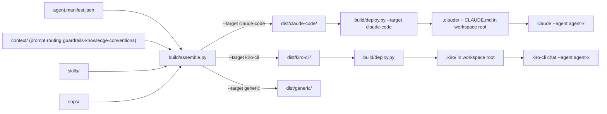
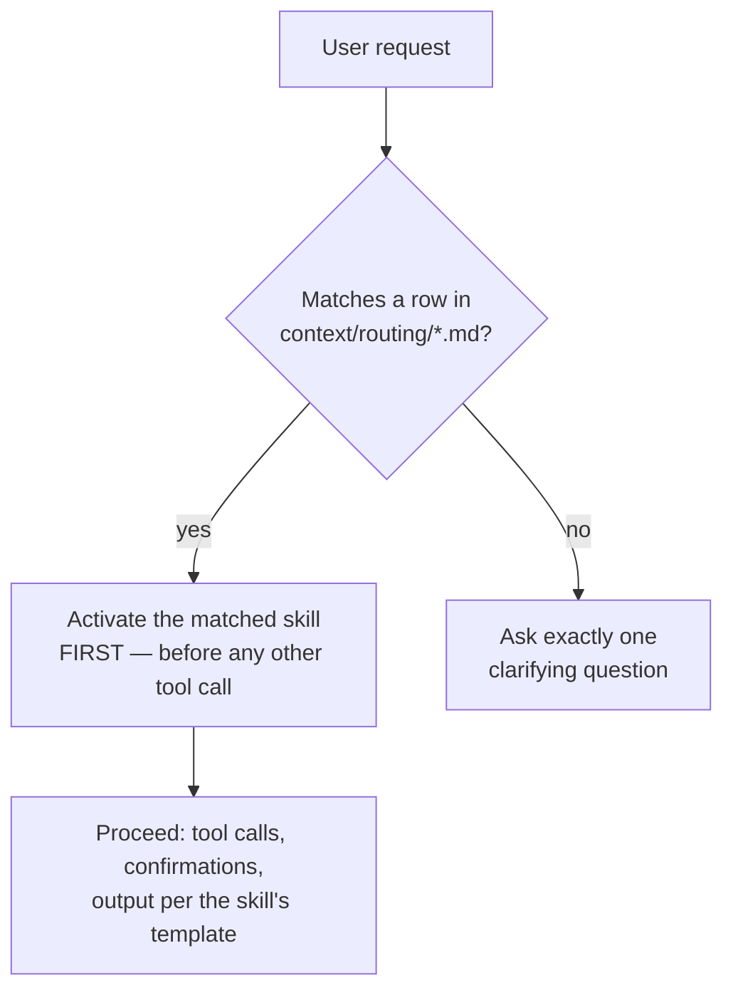
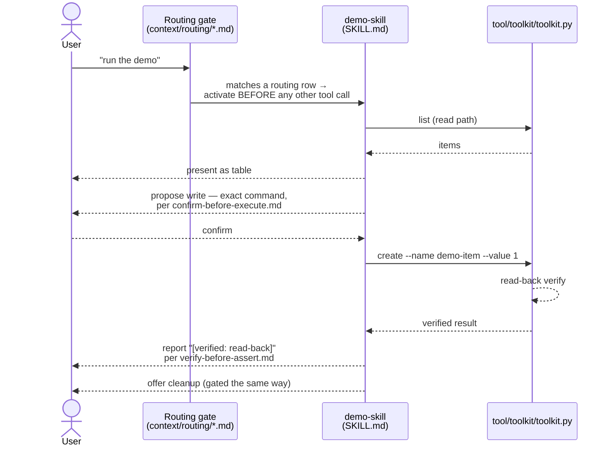

# Agent X

Agent capability package template. Built on the modular capability framework: every capability is explicitly wired, and a validator proves the wiring. A file on disk does nothing until it is wired in.

Agent X is a codename. Keep user-facing names configurable until the final name is chosen.

## Quick start

1. Clone the repo.
2. Deploy the kiro-cli runtime files into the workspace root:

       python3 build/deploy.py

3. Activate the agent:

       kiro-cli chat --agent agent-x
       # or, via the launcher (deploys first, then launches):
       python3 build/kiro_agent.py --agent . --prompt "What agent are you?"

The full rebuild specification is preserved at:

    docs/spec/rebuild-spec.md

## Architecture

    agent-x/
    ├── agent.manifest.json
    ├── wiring.config.json
    ├── build/
    │   ├── assemble.py
    │   ├── target_paths.py
    │   ├── validate_targets.py
    │   ├── ci.py
    │   ├── deploy.py
    │   └── kiro_agent.py
    ├── context/
    │   ├── prompt/
    │   │   ├── 00-identity.md
    │   │   └── 10-domain-template.md
    │   ├── routing/
    │   │   ├── 00-core.md
    │   │   └── 10-domain-template.md
    │   ├── guardrails/
    │   │   ├── no-fabrication.md
    │   │   ├── evidence-gate.md
    │   │   ├── confirm-before-execute.md
    │   │   ├── verify-before-assert.md
    │   │   ├── tool-surface-discipline.md
    │   │   ├── self-report-honesty.md
    │   │   └── scope-boundaries.md
    │   ├── knowledge/
    │   │   ├── known-silent-failures.md
    │   │   └── domain-glossary.md
    │   ├── conventions/
    │   │   └── authoring-conventions.md
    │   ├── prompts/
    │   │   └── readonly-investigator.md
    │   └── scripts/
    │       ├── validate-wiring.py
    │       ├── preflight.py
    │       └── discover.py
    ├── skills/ (4)
    │   ├── session-feedback/
    │   ├── escalation-handoff/
    │   ├── demo-skill/
    │   └── example-skill/
    ├── sops/
    │   ├── wire-new-capability.sop.md
    │   ├── adversarial-review.sop.md
    │   └── example.sop.md
    ├── agents/
    │   ├── readonly-investigator.agent.json
    │   └── registry.local.json.example
    ├── unattended/
    │   ├── README.md
    │   ├── jobs.template.json
    │   └── policy.template.json
    ├── tool/
    │   └── toolkit/
    │       ├── toolkit.py
    │       └── README.md
    ├── hooks/
    │   ├── wire-new-capability.hook.json
    │   ├── wire-on-agent-write.hook.json
    │   ├── wiring-audit.hook.json
    │   └── example.hook.json      # inert copy-me template
    ├── guards/
    │   ├── check-tool-contract.py
    │   └── check-cli-references.py
    ├── tests/
    └── docs/
        ├── progress/PROJECT_PROGRESS.md
        └── spec/rebuild-spec.md

## How it works

`agent.manifest.json` is the single source of truth: it declares which skills, SOPs, and context files belong to this agent. Nothing is loaded because it merely exists on disk — `build/assemble.py` reads the manifest and assembles per-host artifacts from it, and `context/scripts/validate-wiring.py` is the authority that proves every declared capability actually has all its attachment points (a skill with no routing row, an SOP nobody cites, a guardrail missing from the identity list — all hard errors).

One manifest, three independent targets — the same skills and guardrails reach the Kiro CLI, Claude Code, or any other host, each in the file layout that host expects, with no per-host copy-paste to keep in sync.

Context itself splits into five tiers by loading path, not by convention:

| Tier | Loads via | Example |
|---|---|---|
| `context/prompt/` | `systemPromptIncludes` — inlined into the system prompt, in listed order | identity, domain persona |
| `context/routing/` | eager glob — always in context every session | the pre-flight gate, skill dispatch table |
| `context/guardrails/` | eager glob | no-fabrication, confirm-before-execute |
| `context/knowledge/` | eager glob | known silent failures, glossary |
| `context/conventions/` | eager glob | authoring/quality conventions |
| `context/scripts/` | never loaded as context — executable tooling only | `validate-wiring.py` |

A prompt partial is never also matched by a glob (that would load it twice) — the assembler hard-errors if `contextGlobs` ever points back at `context/prompt/`.

The other half of "modular" is dispatch: when a request matches a row in `context/routing/*.md`, activating that skill is the agent's first move — before any other tool call, even a read — because the skill carries the procedures (confirmation gates, output templates) that need to already be in context. A request matching no row gets exactly one clarifying question, never a guess.

### Worked example: one request, traced end to end

Take the shipped `demo-skill` — say "run the demo". Every step below cites the file that actually owns it:

1. **Gate fires first.** "run the demo" matches the row in `context/routing/10-domain-template.md` ("Anything handled by the shipped demo — `demo-skill`"). Per `context/routing/00-core.md`'s pre-flight gate, `demo-skill` MUST be activated before any other tool call — even a read.
2. **Read path.** `demo-skill`'s own `## Workflow` (`skills/demo-skill/SKILL.md`) runs `python3 tool/toolkit/toolkit.py list` and presents the result as a table.
3. **Write path, gated.** The skill proposes adding one item and presents the exact pending command, per `context/guardrails/confirm-before-execute.md` — then waits. Nothing runs yet.
4. **Confirmation → execute → verify.** Only after the user confirms does `toolkit.py create` run. The toolkit read-back-verifies its own write, and the skill reports the result labeled `[verified: read-back]`, per `context/guardrails/verify-before-assert.md` — never claimed as landed on the strength of the write call alone.
5. **Offer cleanup** — also gated the same way.

Swap `demo-skill` for your own first skill and the trace is identical — a routing row you write, activation the gate enforces, a workflow you author, and guardrails that are cited, not restated. That's the whole loop `sops/wire-new-capability.sop.md` walks you through.

> **Live-verified, not just illustrated.** Sent `kiro-cli --agent agent-x "run the demo"` against a real deploy and watched every step above happen: `demo-skill/SKILL.md` was read before anything else, the read path ran and printed the empty store, then it stopped and presented the exact pending command with a source citation (`demo-skill § Workflow step 2–3`) instead of executing — holding even with shell execution fully trusted, i.e. the model honoring the skill's own instruction, not just an external permission wall. Confirming resumed the session, ran the write, and it reported back the toolkit's real `"verified": "read-back"` result labeled accordingly, closing with: *"Wiring loop complete: routing row → skill activation → tool call → confirmation gate → verified result."*

The full mechanics — the eight architectural principles behind this, the wiring validator's complete rule set, and the capability-wiring procedure for adding your own skill — are in `docs/spec/rebuild-spec.md`.

## Declared skills (3)

| Skill | What it does |
|---|---|
| `session-feedback` | Honest session retrospective with root-cause tags |
| `escalation-handoff` | Structured handoff when the agent hits a wall |
| `demo-skill` | Wiring-loop demonstration — replace with your first real skill |

One more directory, `example-skill/`, is an intentionally undeclared template. It is counted in the `skills/ (4)` directory count above but never activated.

## Guardrails

no-fabrication · evidence-gate · confirm-before-execute · verify-before-assert · tool-surface-discipline · self-report-honesty · scope-boundaries

## Validation

Run the source-tree validation gate:

    python3 context/scripts/validate-wiring.py --strict
    python3 guards/check-tool-contract.py
    python3 guards/check-cli-references.py
    python3 -m pytest tests/ -q

Check that each build target still emits every declared capability at the
path that target expects:

    python3 build/validate_targets.py

Or run the canonical local CI gate:

    python3 build/ci.py

On hosts that fire no hook events, running the validator directly is the primary enforcement path. Run it before every commit that touches `skills/`, `context/`, `sops/`, `agent.manifest.json`, or `wiring.config.json`.

## Build targets

Primary target: kiro-cli

    python3 build/assemble.py --target kiro-cli

To make kiro-cli actually load Agent X in this workspace, deploy generated files into `.kiro/`:

    python3 build/deploy.py
    kiro-cli chat --agent agent-x

`.kiro/` is generated output — `build/deploy.py` deletes and rewrites the whole tree on every run. Declare MCP servers in `agent.manifest.json`, not via `kiro-cli mcp add`; edits made directly under `.kiro/` (including via `kiro-cli mcp add`) do not survive the next deploy.

For repeatable kiro-cli testing and agent switching, use the launcher:

    python3 build/kiro_agent.py --agent . --prompt "Run the demo skill" --dry-run
    python3 build/kiro_agent.py --agent . --prompt "Run the demo skill"

To switch agents, pass another agent package path or an alias from `agents/registry.local.json`:

    cp agents/registry.local.json.example agents/registry.local.json
    python3 build/kiro_agent.py --agent /path/to/other-agent --prompt "Smoke test"

The launcher deploys the selected agent into `<workspace-root>/.kiro/` and launches `kiro-cli chat --agent <name>` from that workspace root, because kiro-cli loads agent config from the workspace `.kiro/agents/` directory.

Secondary target: native Claude Code

    python3 build/assemble.py --target claude-code

The `claude-code` target emits a native Claude Code project layout — a thin
root `CLAUDE.md` (the assembled system prompt plus `@`-imports), modular
`.claude/rules/*.md` for the eager context tiers, `.claude/skills/`,
`.claude/sops/`, a `.claude/agents/agent-x.md` that `claude --agent agent-x`
discovers by its frontmatter `name`, and `.claude/settings.json`. To make
Claude Code load Agent X in this workspace:

    python3 build/deploy.py --target claude-code
    claude --agent agent-x

The Claude deploy is *scoped*: it owns a fixed set of paths **wholesale** —
`CLAUDE.md`, `.mcp.json`, `.claude/rules/`, `.claude/skills/`, `.claude/sops/`,
`.claude/agents/`, `.claude/settings.json`, `.claude/hooks.json`. Every deploy
`rmtree`s and regenerates those, and they are gitignored — do not hand-edit
them or drop your own files inside them (a hand-written
`.claude/agents/my-helper.md` is silently lost on the next deploy). Everything
else under `.claude/` (`settings.local.json`, `commands/`, anything you add
outside the owned subpaths) is left untouched. Personalize a fork through
`agent.manifest.json` and `context/`, not by hand-editing the generated files.

Where each target expects what:

| Concept | kiro-cli | Claude Code |
|---|---|---|
| System prompt | `.kiro/steering/00-system.md` | `CLAUDE.md` (thin — prompt + `@`-imports) |
| Eager context | `.kiro/steering/<tier>-*.md` | `.claude/rules/<tier>-*.md` (imported by `CLAUDE.md`) |
| Skills | `.kiro/skills/<name>/` | `.claude/skills/<name>/` |
| SOPs | `.kiro/sops/` | `.claude/sops/` |
| Agent | `.kiro/agents/<name>.json` | `.claude/agents/<name>.md` |
| Subagents | `.kiro/agents/.json` | `.claude/agents/.md` |
| MCP | `.kiro/settings/mcp.json` | `.mcp.json` |
| Hooks / settings | agent-config `hooks` block (not emitted) | `.claude/settings.json`, `.claude/hooks.json` (neutral list) |
| Default agent | `--agent` flag | `--agent` flag, or `.claude/settings.json` `{"agent": …}` |

Portable fallback target:

    python3 build/assemble.py --target generic

## Forking this template

Fork this repo (e.g. `agent-x-mish`, personalized with your own skills) by adding this repo as a remote — conventionally named `template` — and merging its history in once:

    git remote add template <this-repo-url>
    git fetch template
    git merge template/main --allow-unrelated-histories

After that one-time link, pull future template updates any time with:

    python3 build/sync_template.py

It refuses on a dirty working tree, fetches `template`, reports and stops if there's nothing new, merges (`--no-ff`, so every sync leaves a visible commit) and runs `python3 build/ci.py` to confirm nothing broke, and reports merge conflicts without trying to auto-resolve them. It never pushes — review the result, then push yourself. `--remote`/`--branch` override the defaults if your fork uses different names; `--no-test` skips the CI run.

For the full walkthrough — the one-time bootstrap, exactly what an `agent.manifest.json` conflict looks like and how to resolve it, and a real worked example of a fork-local addition and a template update syncing cleanly side by side — see `docs/sync-workflow.md`.

## Wiring a new capability

Follow the rebuild spec's capability wiring procedure in `docs/spec/rebuild-spec.md`. The validator is the authority for whether the capability is actually wired.

## New to this repo?

If you're picking up development here — a new agent/session, or a human contributor — start with `docs/onboarding.md`. It covers the core dev loop (test-first, run `python3 build/ci.py`, keep the spec doc in sync with code), known gotchas already hit once, and where the deeper docs (`docs/spec/rebuild-spec.md`, `docs/sync-workflow.md`, `docs/progress/PROJECT_PROGRESS.md`) each fit in.
